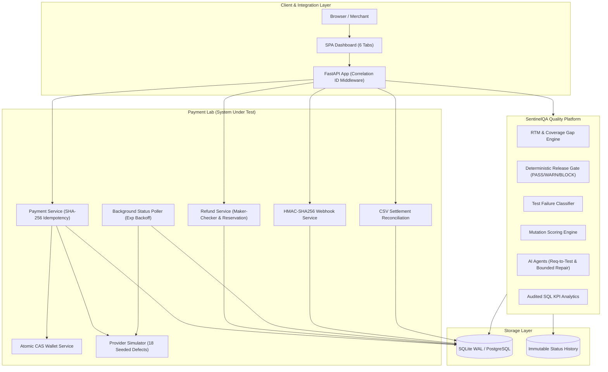

# Sentinel Payment Platform & SentinelQA

[](https://github.com/minhtoanvu/sentinel-payment-platform/actions)


> **Enterprise-grade simulated digital payment platform coupled with an AI-augmented Quality Engineering (QE) intelligence engine.**

---

## 📌 Executive Summary

Modern payment platforms face severe non-functional challenges: network timeouts masquerading as failures, race conditions on wallet balances, out-of-order webhooks, and subtle reconciliation discrepancies. 

**Sentinel Payment Platform** addresses these challenges through two deeply integrated systems:
1. **Payment Lab (System Under Test - SUT):** A high-fidelity digital payment engine with idempotency, concurrency controls, atomic Compare-And-Swap (CAS) state machines, maker-checker refund governance, HMAC webhooks, CSV reconciliation, and 18 toggleable defect flags.
2. **SentinelQA (Quality Engineering Platform):** A QE platform that answers five core engineering questions:
   - *What needs testing?* $\rightarrow$ **Requirements Traceability Matrix (RTM)** & Real-time Coverage Gap Analysis.
   - *Are our tests actually effective?* $\rightarrow$ **Mutation Testing Engine** & 18 Seeded Defect Detection Benchmark.
   - *Why did a test fail?* $\rightarrow$ **Automated Failure Classifier** (Assertion, Timeout, Application Error, Environment, Unknown).
   - *Can we trust AI-generated tests?* $\rightarrow$ **Human-in-the-Loop Review Gate** (`BR-AI-001`), ambiguity detection, and bounded test repair with unified diffs.
   - *Should we release to production?* $\rightarrow$ **Deterministic Release Gate** (PASS / WARN / BLOCK) with immutable audit snapshots and explicit rule IDs.

---

## 🏗️ System Architecture



---

## 🛡️ Core Invariants (INV-01 to INV-08)

The platform enforces 8 non-negotiable architectural invariants:

| ID | Invariant | Enforcement Mechanism |
|---|---|---|
| **INV-01** | **Positive & Bound Amount** | Currency-aware validator (VND: 1,000–50,000,000; USD: 50–1,000,000 cents). |
| **INV-02** | **No Over-Refund** | Atomic balance reservation before refund record insertion; cumulative refunds $\le$ payment amount. |
| **INV-03** | **Non-Negative Balance** | Atomic DB update: `WHERE balance >= amount` with optimistic locking version check. |
| **INV-04** | **Strict Idempotency** | SHA-256 payload hash verification; duplicate key + different payload yields HTTP 409 Conflict. |
| **INV-05** | **Verified Completion** | Payments cannot enter `SUCCEEDED` status without an authenticated provider transaction ID. |
| **INV-06** | **Refund Prerequisite** | Refunds strictly rejected unless parent payment is in `SUCCEEDED` state. |
| **INV-07** | **Maker-Checker Governance** | Large refunds cannot be approved by the same user who created them (`creator_id != approver_id`). |
| **INV-08** | **Pending Conflict Guard** | Unresolved `UNKNOWN` transactions block duplicate merchant reference attempts until polled or resolved. |

---

## 🧪 Comprehensive Test Suite (111 Tests, 89% Coverage)

All 111 tests run automatically on SQLite WAL-mode in under 50 seconds:

```
========================= 111 passed, 1 warning in 49.18s =========================
TOTAL Coverage: 89%
```

### Test Suite Structure

```
tests/
├── unit/
│   ├── test_money_validation.py       # Boundary Value Analysis (TS-003..TS-011)
│   └── test_state_machine.py          # State Transition Matrix & Exceptions (TS-024)
├── api/
│   ├── test_payments_api.py           # Payment creation, idempotency, lifecycle (TS-001..021)
│   ├── test_refunds_api.py            # Maker-checker, partial refunds, window cutoff (TS-031..052)
│   ├── test_webhooks_api.py           # HMAC verification, replay window, dedupe (TS-054..061)
│   ├── test_reconciliation_api.py     # CSV parsing, 8 mismatch types, quarantine (TS-062..069)
│   ├── test_analytics_api.py          # Audited SQL KPI queries verification (TS-092)
│   └── test_dashboard_api.py          # SPA static UI serving & DOM verification
├── concurrency/
│   ├── test_concurrent_idempotency.py # 20 simultaneous identical requests -> 1 payment (TS-015)
│   ├── test_concurrent_confirms.py    # 20 concurrent confirms -> 1 provider execution (TS-031)
│   ├── test_concurrent_refunds.py     # Parallel refunds totaling > 100% -> total <= amount (TS-040)
│   ├── test_concurrent_wallet.py      # Concurrent debits on single wallet -> balance >= 0 (TS-033)
│   └── test_concurrent_webhooks.py    # Parallel identical webhooks -> 1 DB event (TS-051)
├── integration/
│   ├── test_timeout_and_worker.py     # Exponential backoff status worker (TS-026..029)
│   └── test_seeded_defects.py         # Verification of 18 injected defects (BUG-001..BUG-018)
└── sentinelqa/
    ├── test_traceability.py           # RTM coverage gap & untracked requirements (TS-070)
    ├── test_release_gate.py           # Deterministic PASS / WARN / BLOCK decisions (TS-071..073)
    ├── test_failure_classifier.py     # Pattern matching classification (TS-083)
    ├── test_mutation_engine.py        # Mutation scoring & equivalent mutant rules (TS-082)
    ├── test_regression_selector.py    # Changed-file test selection with fallback (TS-075, 089)
    ├── test_sentinel_api.py           # SentinelQA REST API full lifecycle (TS-086..087)
    └── test_ai_agents.py              # LLM adapter, ambiguity detection, human review (TS-077..090)
```

---

## 💻 Web Dashboard (Interactive SPA)

Accessible at `http://localhost:8000/dashboard` or `/`:

1. **💳 Payments Tab:** Create, confirm, and simulate payments with real-time transition status timeline.
2. **🔄 Refunds Tab:** Trigger partial/full refunds and manage Maker-Checker dual approvals.
3. **📁 Reconciliation Tab:** Upload settlement CSVs, monitor mismatch findings, and inspect quarantined rows.
4. **🚦 SentinelQA Release Gate:** Real-time PASS/WARN/BLOCK evaluation, coverage gap metrics, and test execution history.
5. **📈 SQL KPI Analytics:** Live platform metrics with full display of the audited SQL query behind every number.
6. **🐛 Seeded Defects Catalog:** Interactive catalog of 18 simulated bugs with feature flag toggle references.

---

## 🚀 Quick Start Guide

### 1. Clone & Set Up Virtual Environment

```bash
git clone https://github.com/minhtoanvu/sentinel-payment-platform.git
cd sentinel-payment-platform

python -m venv .venv
# Windows:
.venv\Scripts\activate
# Linux/macOS:
source .venv/bin/activate

pip install -e ".[dev]"
```

### 2. Configure Environment

```bash
cp .env.example .env
```

### 3. Seed Demo Data & SentinelQA Scenarios

Populate merchants, wallets, 95 test scenarios, 58 requirements, and 18 seeded defects:

```bash
python scripts/seed_demo_data.py
python scripts/seed_sentinel_scenarios.py
```

### 4. Run the Full Test Suite

```bash
pytest -v --cov=payment_lab --cov=sentinelqa --cov-report=term-missing
```

### 5. Launch the Server & Open Dashboard

```bash
uvicorn apps.api.main:app --reload --port 8000
```
Visit `http://localhost:8000/dashboard` in your browser.

---

## 🎯 Golden Path Demo (GP-01 Walkthrough)

To witness the complete lifecycle of timeout handling and Quality Engineering intervention in a single command:

```bash
python scripts/demo_golden_path_gp01.py
```

### What GP-01 verifies:
1. **Scenario Setup:** Set `PL_DEFECT_BUG_004=false` and run Provider Simulator with scenario `timeout_success`.
2. **Execution:** Merchant creates a payment and confirms. Provider simulator delays response.
3. **System Behavior:** Payment transitions to `UNKNOWN`. Background worker (`StatusWorker`) polls provider with exponential backoff.
4. **Resolution:** Provider confirms transaction $\rightarrow$ payment transitions to `SUCCEEDED` without double debiting.
5. **Quality Gate Evaluation:** 
   - Toggle `PL_DEFECT_BUG_004=true` (simulating premature failure marking on timeout).
   - Run regression selector $\rightarrow$ selects TS-026, TS-027, TS-028.
   - Tests fail with double charge detection $\rightarrow$ SentinelQA Release Gate issues **BLOCK** decision with Rule ID `RG-FAIL-P0-BLOCK`.
6. **Failure Analysis & Audited SQL:** Categorized as `ASSERTION` error and displays the audited SQL query for timeout recovery metrics.

---

## 📖 Complete Documentation Index

For in-depth domain specifications and artifacts, see the [`docs/`](docs/) directory:

| Role / Perspective | Recommended Reading Order |
|---|---|
| **Business Analyst (BA)** | [01. Business Case](docs/business-analysis/01_business_case_and_stakeholders.md) $\rightarrow$ [02. Use Cases](docs/business-analysis/02_use_cases.md) $\rightarrow$ [03. User Stories](docs/business-analysis/03_user_stories.md) $\rightarrow$ [09. Traceability Matrix CSV](docs/business-analysis/09_traceability_matrix.csv) |
| **QA / SDET** | [Test Scenarios (95 Specs)](docs/testing/test-scenarios.md) $\rightarrow$ [Business Rules (62 Rules)](docs/domain/business-rules.md) $\rightarrow$ [Payment Lifecycle](docs/domain/payment-lifecycle.md) $\rightarrow$ [Metrics & Formulae](docs/metrics.md) |
| **AI Engineer** | [PRD §6 Golden Path](docs/PRD.md) $\rightarrow$ [Business Rules BR-AI-*](docs/domain/business-rules.md) $\rightarrow$ [AI Telemetry & Evaluation](docs/metrics.md) |
| **Backend Engineer** | [Architecture Overview](docs/architecture/overview.md) $\rightarrow$ [Data Model & ERD](docs/architecture/data-model.md) $\rightarrow$ [OpenAPI Spec](docs/architecture/openapi.yaml) $\rightarrow$ [ADR Decision Log](docs/architecture/adr/ADR-log.md) |
| **Data Analyst (DA)** | [Platform Metrics](docs/metrics.md) $\rightarrow$ [Audited SQL KPI Analytics](docs/PRD.md) $\rightarrow `payment_lab/services/analytics_service.py` |

---

## 📄 License

This project is licensed under the MIT License - see the LICENSE file for details.

