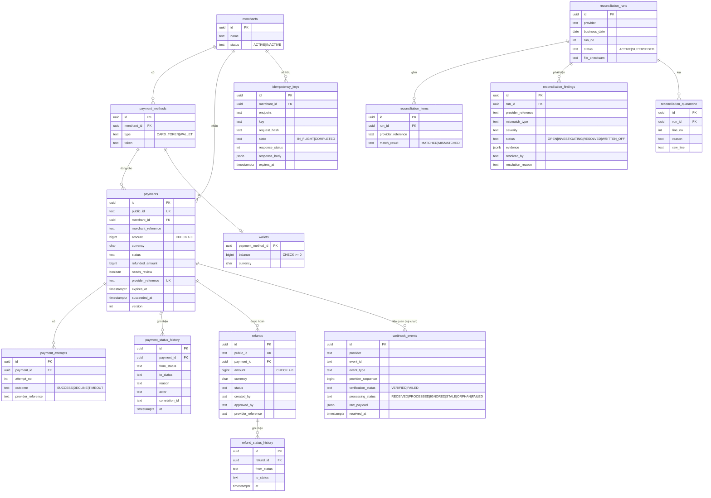

# Data Model

Phiên bản 0.1. Mô hình đích; triển khai bằng các migration nhỏ theo từng phase (không tạo toàn bộ bảng ngay). Hai schema PostgreSQL: `payment_lab` và `sentinelqa`.

## Quy ước chung
- Khóa chính dạng UUID (ví dụ UUIDv7 nếu thư viện hỗ trợ, nếu không UUIDv4) kèm `public_id` có tiền tố cho API (`pay_…`, `ref_…`).
- **Tiền:** `amount BIGINT` theo minor unit + `currency CHAR(3)`; `CHECK (amount > 0)`. Không dùng FLOAT/DOUBLE.
- Thời gian: `TIMESTAMPTZ` lưu UTC; ngày nghiệp vụ tính theo `Asia/Ho_Chi_Minh` (BR-REC-001).
- Mọi bảng có `created_at`; bảng thay đổi có `updated_at` và `version` (optimistic locking khi cần).
- Trạng thái dùng `TEXT` + `CHECK (status IN (...))` hoặc ENUM; thay đổi trạng thái chỉ qua tầng domain.

## 1. ERD — Payment Lab

### Ràng buộc và chỉ mục quan trọng (Payment Lab)

| Bảng | Ràng buộc / chỉ mục | Phục vụ quy tắc |
|---|---|---|
| payments | `CHECK (amount > 0)`; `CHECK (refunded_amount BETWEEN 0 AND amount)` | BR-PAY-001, BR-REF-008 |
| payments | **Partial UNIQUE** `(merchant_id, merchant_reference) WHERE status = 'SUCCEEDED'` | BR-PAY-005 / INV-01 |
| payments | UNIQUE `provider_reference` (khi không NULL) | Khóa đối soát |
| payments | INDEX `(merchant_id, status, created_at DESC)`; INDEX `(status, expires_at)` | Truy vấn danh sách, job expiry |
| payment_status_history | Quyền DB: chỉ INSERT; trigger chặn UPDATE/DELETE | BR-PAY-010 |
| refunds | `CHECK (amount > 0)`; INDEX `(payment_id, status)` | BR-REF-002/003 |
| idempotency_keys | **UNIQUE** `(merchant_id, endpoint, key)`; INDEX `expires_at` | BR-IDEM-007 |
| webhook_events | **UNIQUE** `(provider, event_id)` | BR-WH-003 / INV-08 |
| wallets | `CHECK (balance >= 0)` | BR-PAY-013 / INV-03 |
| reconciliation_runs | UNIQUE `(provider, business_date, run_no)` | BR-REC-005 |
| reconciliation_findings | UNIQUE `(run_id, provider_reference, mismatch_type)` | BR-REC-005 |

> Các ràng buộc ở tầng DB là **chốt chặn cuối cùng**; logic domain vẫn kiểm tra trước để trả lỗi có nghĩa. Trong benchmark, một số seeded defect (BUG-005, BUG-008, BUG-016) được cài ở tầng ứng dụng *bỏ qua khóa*, do đó cần giữ các phiên bản cờ lỗi tách biệt với ràng buộc DB (cờ lỗi không được vô hiệu hóa constraint trừ khi chủ đích ghi rõ).

## 2. ERD — SentinelQA

```mermaid
erDiagram
    requirements ||--o{ requirement_versions : "có"
    requirements ||--o{ requirement_test_links : "liên kết"
    test_cases ||--o{ requirement_test_links : "liên kết"
    test_cases ||--o{ test_case_versions : "có"
    test_runs ||--o{ test_results : "gồm"
    test_cases ||--o{ test_results : "kết quả"
    test_results ||--o{ test_artifacts : "đính kèm"
    test_results }o--o| defects : "liên quan"
    requirements ||--o{ defects : "vi phạm"
    commits ||--o{ test_runs : "chạy trên"
    commits ||--o{ change_impact_selections : "phân tích"
    test_runs ||--o{ release_decisions : "căn cứ"
    agent_runs ||--o{ agent_steps : "gồm"
    agent_runs ||--o{ generated_tests : "tạo ra"
    evaluation_datasets ||--o{ evaluation_cases : "gồm"
    evaluation_runs ||--o{ evaluation_results : "gồm"
    evaluation_cases ||--o{ evaluation_results : "được chấm"
    mutation_runs ||--o{ mutants : "gồm"

    requirements {
        uuid id PK
        text public_id UK "FR-PAY-006"
        text title
        text priority "Must|Should|Could"
        text severity "Critical|High|Medium|Low"
    }
    requirement_versions {
        uuid id PK
        uuid requirement_id FK
        int version
        text description
        jsonb acceptance_criteria
    }
    test_cases {
        uuid id PK
        text public_id UK "TS-026"
        text level "UNIT|API|INT|CONC|UI|SEC|AI"
        text priority "P0|P1|P2"
        text status "DRAFT|APPROVED|DEPRECATED"
        text origin "HUMAN|AI"
    }
    test_case_versions {
        uuid id PK
        uuid test_case_id FK
        int version
        jsonb steps
        text approved_by
    }
    requirement_test_links {
        uuid requirement_id FK
        uuid test_case_id FK
    }
    commits {
        uuid id PK
        text sha UK
        text branch
        text diff_ref
    }
    change_impact_selections {
        uuid id PK
        uuid commit_id FK
        text method "RUN_ALL|CHANGED_FILE_RULES|SENTINELQA"
        jsonb selected_tests
        jsonb reasons
        text confidence
        boolean fallback_used
    }
    test_runs {
        uuid id PK
        uuid commit_id FK
        text environment
        text runner_version
        text trigger
        timestamptz started_at
        timestamptz finished_at
    }
    test_results {
        uuid id PK
        uuid run_id FK
        uuid test_case_id FK
        text outcome "PASS|FAIL|ERROR|SKIPPED"
        text failure_class
        int duration_ms
    }
    test_artifacts {
        uuid id PK
        uuid result_id FK
        text kind "LOG|SCREENSHOT|TRACE"
        text uri
    }
    defects {
        uuid id PK
        uuid requirement_id FK
        text seeded_code "BUG-004 hoặc NULL"
        text severity
        text status
    }
    mutation_runs {
        uuid id PK
        text target_module
        text tool_version
        int seed
    }
    mutants {
        uuid id PK
        uuid run_id FK
        text operator
        text location
        text status "KILLED|SURVIVED|EQUIVALENT|INVALID"
        text justification
    }
    release_decisions {
        uuid id PK
        uuid run_id FK
        text decision "PASS|WARN|BLOCK"
        jsonb rule_ids
        jsonb input_snapshot
        jsonb thresholds
        text ruleset_version
    }
    agent_runs {
        uuid id PK
        text model
        text prompt_version
        int total_tokens
        numeric cost_usd
        int latency_ms
        text status
    }
    agent_steps {
        uuid id PK
        uuid agent_run_id FK
        int step_no
        text kind "MODEL|TOOL_CALL|TOOL_RESULT"
        jsonb payload
    }
    generated_tests {
        uuid id PK
        uuid agent_run_id FK
        uuid requirement_id FK
        text status "DRAFT|APPROVED|REJECTED"
        text approved_by
    }
    evaluation_datasets {
        uuid id PK
        text version
        text split "DEV|HELD_OUT"
    }
    evaluation_cases {
        uuid id PK
        uuid dataset_id FK
        text requirement_text
        jsonb expected_behaviors
        jsonb ambiguity_labels
        text review_status
    }
    evaluation_runs {
        uuid id PK
        text config_name
        text model
        text prompt_version
        int seed
    }
    evaluation_results {
        uuid id PK
        uuid run_id FK
        uuid case_id FK
        jsonb metrics
    }
```

### Ràng buộc quan trọng (SentinelQA)
- `generated_tests.approved_by` phải khác `created_by` và khác định danh agent (BR-AI-001): kiểm tra ở tầng domain **và** CHECK/trigger.
- `test_results` bắt buộc `commit_id` (qua `test_runs`), `environment`, `runner_version` (BR-QE-001).
- `release_decisions` bất biến (không UPDATE); thay đổi quyết định ghi bản mới có tham chiếu bản trước.
- `evaluation_results` tham chiếu `dataset.version` và `evaluation_runs.seed` để tái lập.
- `mutants.justification` NOT NULL khi `status = 'EQUIVALENT'` (BR-QE-002).

## 3. Từ điển dữ liệu — các trường dễ nhầm

| Trường | Ý nghĩa | Lưu ý |
|---|---|---|
| `payments.provider_reference` | Mã giao dịch phía provider | Khóa đối soát; có thể chưa có khi CREATED |
| `payments.needs_review` | Cờ cần người xử lý khi UNKNOWN quá số lần hỏi | Không phải một status |
| `refunds.status` đang giữ chỗ | PENDING_APPROVAL, REQUESTED, PROCESSING, UNKNOWN | Dùng khi tính refundable |
| `webhook_events.processing_status` | Kết quả xử lý nội bộ | Khác `verification_status` |
| `reconciliation_findings.severity` | Mức nghiêm trọng của mismatch | FAILED nội bộ nhưng SETTLED ở provider = cao |
| `defects.seeded_code` | Mã lỗi cài sẵn BUG-xxx | NULL với lỗi tự nhiên |
| `test_results.failure_class` | Phân loại failure | Mặc định UNKNOWN (BR-QE-004) |

## 4. Kế hoạch migration

| Migration | Nội dung | Phase |
|---|---|---|
| 0001 | merchants, payment_methods, wallets | 1 |
| 0002 | payments, payment_attempts, payment_status_history, idempotency_keys | 1 |
| 0003 | refunds, refund_status_history | 1 |
| 0004 | webhook_events | 1 |
| 0005 | reconciliation_* | 1 |
| 0006 | requirements, test_cases, links, runs, results, artifacts, defects | 2 |
| 0007 | commits, change_impact_selections, mutation_runs, mutants | 3 |
| 0008 | release_decisions | 3 |
| 0009 | agent_runs, agent_steps, generated_tests | 4 |
| 0010 | evaluation_* | 5 |
