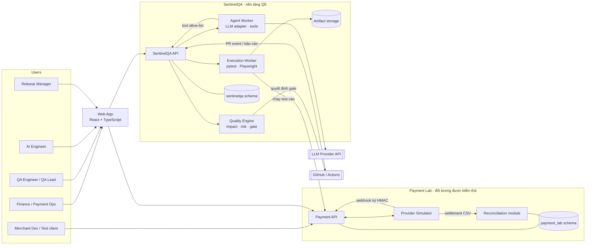

# Architecture Overview

Phiên bản 0.1. Kiến trúc mục tiêu cho v1.0: **modular monolith + worker**, một PostgreSQL, Docker Compose. Không microservices, không Kubernetes, không Kafka. Lý do và đánh đổi nằm trong [ADR log](adr/ADR-log.md).

## 1. Context diagram



**Ranh giới quan trọng:** SentinelQA chỉ tương tác với Payment Lab như một **client bên ngoài** (qua API công khai, dữ liệu test, và cờ lỗi). Hai hệ thống dùng hai schema riêng trong cùng một PostgreSQL ở v1.0 để tiết kiệm tài nguyên, nhưng không truy cập chéo bảng.

## 2. Thành phần và trách nhiệm

| Thành phần | Trách nhiệm | Công nghệ | Phase |
|---|---|---|---|
| Payment API | Payment, refund, webhook, idempotency, state machine, audit | FastAPI, Pydantic, SQLAlchemy | 1 |
| Provider Simulator | Kịch bản provider, webhook có ký, status query, settlement file; cờ lỗi | Module Python (cùng process ở v1.0) | 1 |
| Reconciliation module | Import, so khớp, phân loại, báo cáo | Python, SQL | 1 |
| Status Worker | Hỏi lại trạng thái UNKNOWN, expiry, retry webhook nội bộ | Job queue đơn giản | 1 |
| SentinelQA API | Requirements, test cases, runs, results, decisions, dashboards | FastAPI | 2 |
| Execution Worker | Chạy pytest/Playwright, thu artifacts, gắn commit/môi trường | pytest, Playwright | 2 |
| Quality Engine | Change impact, mutation orchestration, failure classification, flaky, release gate | Python thuần, SQL | 3 |
| Agent Worker | LLM adapter, agent loop, tool allow-list, trace, sandbox runner | Python, LLM API | 4 |
| Evaluation Runner | Dataset, evaluators, benchmark, báo cáo so sánh | Python | 5 |
| Web App | UI Payment Lab, SentinelQA, dashboard | React, TypeScript | 1–5 |
| CI | Lint, type check, test, gate, artifacts | GitHub Actions | 2+ |

## 3. Luồng dữ liệu chính

1. **Giao dịch:** Merchant → Payment API → DB → Provider Simulator → (webhook) → Payment API → audit.
2. **Kiểm thử:** PR → CI → SentinelQA API (diff) → Quality Engine chọn test → Execution Worker chạy vào Payment API → results/artifacts → DB.
3. **Phân tích:** results → failure classification, flaky, mutation → tín hiệu.
4. **Quyết định:** tín hiệu → Release Gate → decision + snapshot → CI.
5. **AI:** requirement → Agent Worker → LLM → structured output → validate → sandbox chạy thử → DRAFT → người duyệt → APPROVED vào suite.
6. **Đánh giá:** dataset phiên bản hóa → Evaluation Runner → metrics → dashboard AI.

## 4. Cấu trúc repository (khi bắt đầu code)

```
sentinelqa/
├── apps/
│   ├── api/            # FastAPI: payment-lab và sentinelqa là hai package riêng
│   └── web/            # React + TypeScript
├── workers/            # status-worker, execution-worker, agent-worker
├── payment_lab/        # domain, state machine, simulator, reconciliation
├── sentinelqa/         # quality engine, gate, evaluation
├── tests/              # unit, integration, api, e2e, concurrency, performance, mutation, ai_evaluation
├── datasets/           # requirements, evaluation, synthetic-payments
├── analytics/          # sql, notebooks, dashboard, reports, data_dictionary.md
├── docs/               # tài liệu trong thư mục này
├── infra/              # docker, deployment
├── scripts/
├── docker-compose.yml
└── .env.example
```

Chỉ tạo thư mục khi milestone cần dùng.

## 5. Các thuộc tính chất lượng và cách đáp ứng

| Thuộc tính | Chiến lược |
|---|---|
| Tính đúng của tiền | Số nguyên minor unit; CHECK constraint; khóa dòng; test bất biến |
| Idempotency | Bảng `idempotency_keys` UNIQUE + cùng transaction với resource |
| Chống trùng webhook | UNIQUE `(provider, event_id)` |
| Concurrency | `SELECT … FOR UPDATE` trên payment khi confirm/refund; kiểm tra bất biến sau mỗi test tải |
| Khả năng quan sát | `correlation_id` xuyên suốt; log JSON; bảng audit |
| Tái lập | Seed cố định; đồng hồ điều khiển được; dataset/prompt/model có phiên bản |
| Bảo mật | HMAC webhook, RBAC, secrets qua env, sandbox cho test AI, allow-list tool, không PII thật |
| Tiết kiệm tài nguyên | Một DB, worker bật khi cần, AI qua API ngoài |
| Khả năng mở rộng (định hướng) | Tách worker thành service riêng; thay job queue đơn giản bằng Redis/RQ khi cần |

## 6. Mô hình đe dọa tóm tắt (STRIDE rút gọn, sẽ chi tiết ở Phase 6)

| Đe dọa | Ví dụ | Biện pháp |
|---|---|---|
| Spoofing | Giả webhook | HMAC + timestamp + dedupe |
| Tampering | Sửa audit/giao dịch | Audit append-only; quyền DB tối thiểu |
| Repudiation | Phủ nhận thao tác duyệt refund | Audit có actor, correlation_id |
| Information disclosure | Merchant đọc dữ liệu merchant khác; lộ secret trong log | RBAC + kiểm tra sở hữu; log sạch (TS-068, TS-069) |
| Denial of service | Request flood | Rate limit, giới hạn kích thước |
| Elevation of privilege | Agent gọi tool ngoài quyền, prompt injection | Allow-list, dữ liệu không tin cậy, không tự approve (TS-077, TS-079) |
