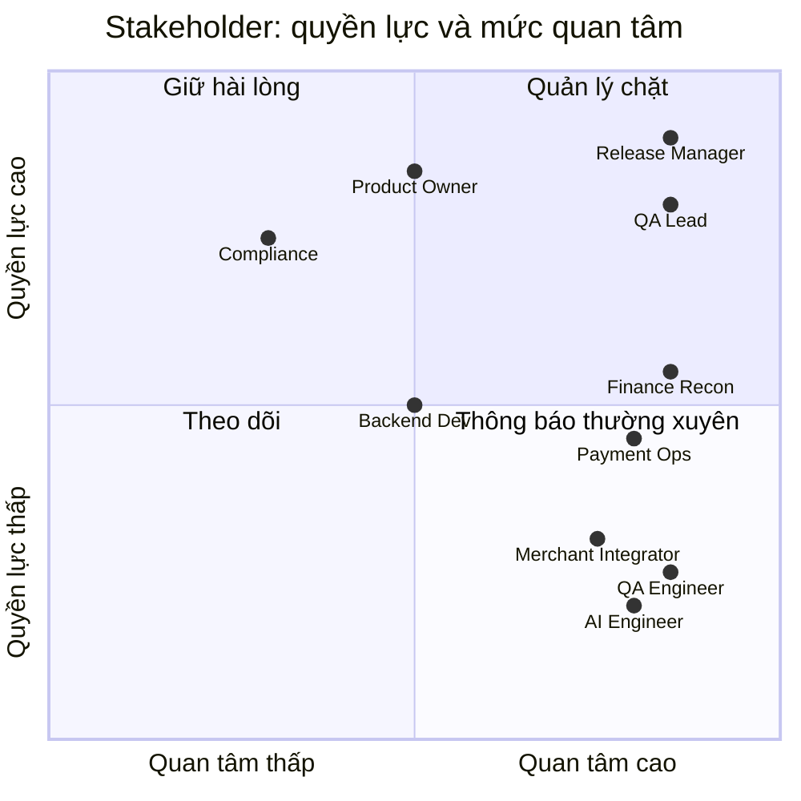
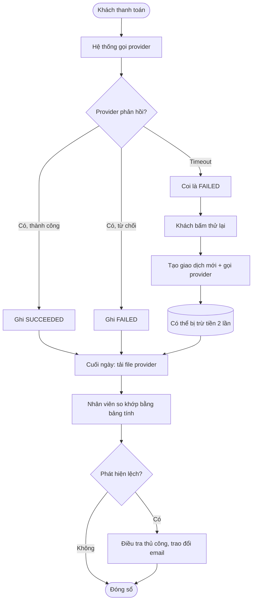
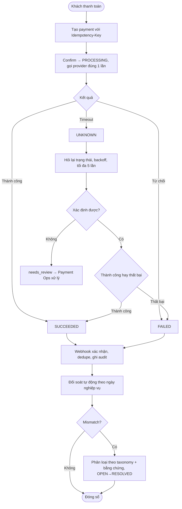
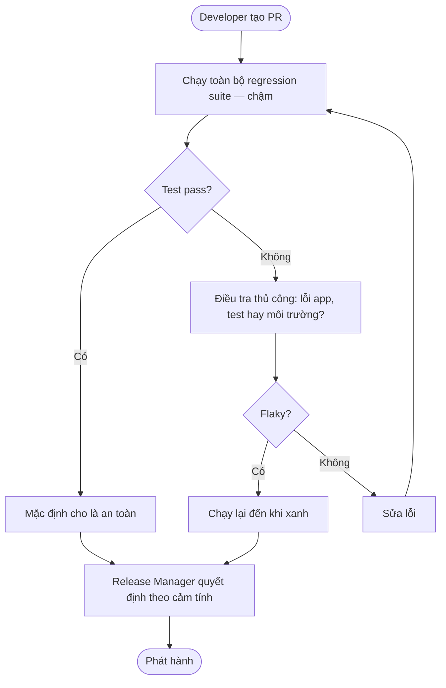
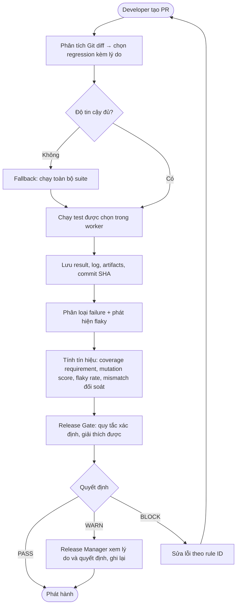

# Business Case, Stakeholder Analysis và AS-IS / TO-BE

Phiên bản 0.1. Đây là bộ tài liệu BA gốc cho nhánh BA của portfolio. Các sơ đồ Mermaid dưới đây là bản nháp luồng; ở Tuần 2 cần vẽ lại thành file BPMN 2.0 (`04_bpmn_as_is.bpmn`, `05_bpmn_to_be.bpmn`) bằng Camunda Modeler hoặc draw.io.

## 1. Business case

### 1.1 Vấn đề kinh doanh
Một đơn vị cung cấp dịch vụ thanh toán số (hoặc đội tích hợp thanh toán) chịu ba nhóm tổn thất khi phần mềm lỗi:

| Nhóm tổn thất | Ví dụ | Hệ quả |
|---|---|---|
| **Tài chính trực tiếp** | Trừ tiền hai lần, hoàn vượt mức, lệch đối soát | Thất thoát, chi phí hoàn trả, tranh chấp |
| **Vận hành** | Giao dịch treo, điều tra thủ công bằng bảng tính | Chi phí nhân sự, chậm đóng sổ |
| **Uy tín và tuân thủ** | Khách mất niềm tin, sai lệch dữ liệu tài chính | Mất khách, rủi ro pháp lý |

Đồng thời, đội kiểm thử thiếu công cụ chứng minh *test có đủ mạnh hay không* và *có nên phát hành hay không*, nên quyết định phát hành dựa nhiều vào cảm tính.

### 1.2 Giải pháp đề xuất
- **Payment Lab:** môi trường mô phỏng nghiệp vụ thanh toán có các lỗi tinh vi tái lập được.
- **SentinelQA:** nền tảng đo chất lượng kiểm thử, chọn regression theo thay đổi, đánh giá AI hỗ trợ test, và ra quyết định phát hành có giải thích.

### 1.3 Mục tiêu kinh doanh và chỉ số (SMART — giả thuyết cần đo)
| Mã | Mục tiêu | Chỉ số | Mục tiêu giả thuyết | Cách đo |
|---|---|---|---|---|
| BG-01 | Giảm rủi ro lỗi nghiệp vụ tiền | Detection rate trên 18 seeded defects | ≥ 90% | Bật từng cờ lỗi, chạy suite |
| BG-02 | Giảm thời gian regression | Time saved khi chọn test theo thay đổi | ≥ 40% với recall ≥ 95% | Benchmark trên tập commit |
| BG-03 | Giảm nhiễu do test không ổn định | Flaky rate sau khi cô lập | Có số liệu trước/sau | Rerun N=10 |
| BG-04 | Phát hành có căn cứ | Tỷ lệ quyết định gate có đủ lý do và snapshot | 100% | Kiểm tra bản ghi |
| BG-05 | Dùng AI có kiểm chứng | Execution success và mutation detection của test AI sinh | Công bố so với baseline test viết tay | Evaluation runner |

*Các con số là giả thuyết đặt trước để kiểm chứng. Kết quả thực tế có thể thấp hơn và vẫn phải được công bố.*

### 1.4 Phạm vi, giả định, ràng buộc
Xem PRD mục 5, 9. Điểm then chốt: dữ liệu tổng hợp; không tiền thật; một người thực hiện.

### 1.5 Phân tích phương án
| Phương án | Ưu | Nhược | Quyết định |
|---|---|---|---|
| A. Chỉ viết bộ test cho một ứng dụng demo | Nhanh | Không đo được chất lượng test; domain nghèo | Loại |
| B. Tích hợp công cụ AI testing thương mại | Nhanh, đầy đủ | Không chứng minh được năng lực xây dựng; chi phí | Loại |
| C. Xây Payment Lab + SentinelQA (modular monolith) | Chứng minh nhiều năng lực; kiểm soát được | Phạm vi lớn; cần kỷ luật | **Chọn** |
| D. Chia thành 4–5 dự án nhỏ độc lập | Dễ hoàn thành từng phần | Thiếu liên kết, khó kể một câu chuyện | Loại |

### 1.6 Rủi ro chính
Xem PRD mục 11.

## 2. Phân tích stakeholder

### 2.1 Danh sách và ảnh hưởng

| Stakeholder | Vai trò | Quyền lực | Quan tâm | Chiến lược | Kỳ vọng chính |
|---|---|---|---|---|---|
| Release Manager | Quyết định phát hành | Cao | Cao | Quản lý chặt | Quyết định có căn cứ, lý do rõ |
| QA Lead | Sở hữu chiến lược test | Cao | Cao | Quản lý chặt | Biết coverage thật, giảm thời gian regression |
| Head of Payments / Product Owner | Sở hữu sản phẩm thanh toán | Cao | Trung bình | Giữ hài lòng | Không có sự cố tài chính |
| Finance / Reconciliation Team | Đóng sổ, đối soát | Trung bình | Cao | Thông báo thường xuyên | Sai lệch được phân loại, có bằng chứng |
| Payment Operations | Xử lý khiếu nại, giao dịch treo | Trung bình | Cao | Thông báo thường xuyên | Trạng thái rõ, không phải điều tra thủ công |
| QA Engineers / SDET | Viết và duy trì test | Thấp | Cao | Thông báo | Công cụ hỗ trợ, ít flaky |
| Backend Developers | Xây hệ thống thanh toán | Trung bình | Trung bình | Thông báo | Phản hồi lỗi nhanh, tái lập được |
| AI/ML Engineers | Xây tính năng AI | Thấp | Cao | Thông báo | Benchmark công bằng, không thiên vị |
| Merchant Integrators | Tích hợp API | Thấp | Cao | Thông báo | API nhất quán, retry an toàn |
| Compliance / Security | Rủi ro, kiểm soát nội bộ | Cao | Thấp–Trung bình | Giữ hài lòng | Maker-checker, audit, không lộ dữ liệu |
| Nhà tuyển dụng (người đánh giá portfolio) | Đánh giá năng lực người thực hiện | Cao | Cao | — | Bằng chứng có thể kiểm tra, trung thực về giới hạn |

### 2.2 Ma trận quyền lực – mức quan tâm

### 2.3 Nhu cầu → yêu cầu
| Nhu cầu stakeholder | Yêu cầu liên quan |
|---|---|
| Release Manager cần quyết định có lý do | FR-GATE-001, FR-GATE-002 |
| QA Lead cần biết yêu cầu nào chưa được test | FR-REQ-002, FR-REQ-003 |
| Finance cần phân loại sai lệch có bằng chứng | FR-REC-002, FR-REC-004, FR-REC-005 |
| Payment Ops cần trạng thái rõ khi timeout | FR-PAY-006, FR-UI-001 |
| Merchant cần retry an toàn | FR-PAY-003, FR-REF-004 |
| Compliance cần kiểm soát refund lớn | FR-REF-006, FR-PAY-010, FR-SEC-001 |
| AI Engineer cần so sánh khoa học | FR-EVAL-001, FR-EVAL-002 |

## 3. Quy trình AS-IS và TO-BE

### 3.1 Nghiệp vụ A — Xử lý giao dịch timeout và đối soát

**AS-IS (hiện trạng điển hình):** timeout bị coi là thất bại; khách thử lại; cuối ngày nhân viên đối soát bằng bảng tính.

| Điểm nghẽn (pain point) | Hệ quả |
|---|---|
| Timeout coi là thất bại | Trừ tiền hai lần |
| Không có trạng thái "chưa xác định" | Không biết giao dịch nào cần kiểm tra |
| Đối soát thủ công cuối ngày | Phát hiện muộn, tốn nhân lực, dễ sai |
| Không phân loại sai lệch | Mất thời gian điều tra |

**TO-BE (Payment Lab):**

| Cải tiến | Quy tắc | Lợi ích |
|---|---|---|
| Trạng thái UNKNOWN + status query | BR-PAY-008, BR-PAY-009 | Không trừ tiền hai lần |
| Idempotency | BR-IDEM-* | Retry an toàn |
| Webhook xác thực + dedupe | BR-WH-* | Dữ liệu đúng, không lặp |
| Đối soát tự động có phân loại | BR-REC-* | Phát hiện sớm, điều tra nhanh |

### 3.2 Nghiệp vụ B — Quyết định phát hành phần mềm

**AS-IS:** chạy toàn bộ regression hoặc chọn thủ công, tin vào test pass, quyết định bằng cảm tính.

**TO-BE (SentinelQA):**

### 3.3 Đánh giá thay đổi (gap analysis)
| Năng lực | AS-IS | TO-BE | Khoảng cách cần lấp |
|---|---|---|---|
| Xử lý timeout | Coi là thất bại | Trạng thái UNKNOWN + status query | State machine, worker, simulator |
| Retry | Tạo giao dịch trùng | Idempotency | Bảng idempotency, constraint |
| Đối soát | Bảng tính thủ công | Tự động, phân loại | Import, thuật toán, báo cáo |
| Chọn regression | Toàn bộ/thủ công | Theo diff, có lý do, có fallback | Git ingestion, mapping |
| Đo hiệu quả test | Không có | Mutation + seeded defects | Mutation runner, cờ lỗi |
| Quyết định phát hành | Cảm tính | Rule-based, truy vết | Release gate, snapshot |
| Dùng AI | Không kiểm chứng | Execution-grounded + evaluation | Agent, evaluation runner |

## 4. Quy trình quản lý thay đổi yêu cầu (tóm tắt)

1. Ghi **Change Request** (CR-xxx): mô tả, lý do, người đề xuất.
2. **Phân tích tác động** bằng traceability matrix: requirement, business rule, test, story, tài liệu bị ảnh hưởng.
3. Đánh giá chi phí, rủi ro, ảnh hưởng đến roadmap.
4. Quyết định (chấp nhận / hoãn / từ chối) và ghi vào lịch sử thay đổi PRD.
5. Cập nhật tài liệu, test, traceability; tăng phiên bản.

*Ví dụ CR-001 (để thực hành ở Tuần 2): đổi hạn mức tối đa từ 50.000.000 VND lên 100.000.000 VND — liệt kê BR-PAY-002, TS-006, TS-007, TS-004..TS-009, BUG-007, story US-001, tài liệu OpenAPI.*

## 5. Kế hoạch UAT (khung)

| Hạng mục | Nội dung |
|---|---|
| Mục tiêu | Người dùng nghiệp vụ xác nhận luồng thanh toán, hoàn tiền, đối soát đáp ứng nhu cầu |
| Người tham gia | Đóng vai Payment Ops, Finance, Merchant Integrator |
| Kịch bản | UAT-01 thanh toán thành công; UAT-02 timeout rồi tự phục hồi; UAT-03 hoàn tiền một phần hai lần; UAT-04 đối soát có lệch và xử lý; UAT-05 bị chặn do refund vượt mức |
| Tiêu chí chấp nhận | Mọi kịch bản đạt expected result; không lỗi nghiêm trọng mở |
| Sign-off | Biên bản có ngày, người, kết quả, vấn đề tồn đọng |

Chi tiết từng kịch bản UAT sẽ được viết ở Tuần 2 (`10_uat_plan.md`), dựa trên use case và acceptance criteria.
