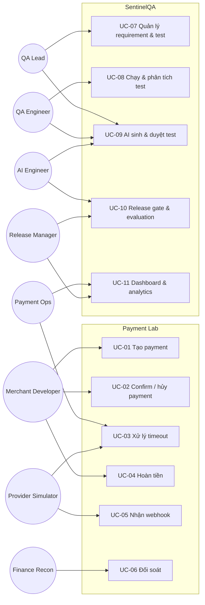

# Use Case Specifications

Phiên bản 0.1. 11 use case: UC-01 đến UC-06 thuộc Payment Lab (mô tả đầy đủ), UC-07 đến UC-11 thuộc SentinelQA (mô tả ngắn hơn, sẽ chi tiết hóa ở Phase tương ứng). Mỗi use case tham chiếu requirement (FR), business rule (BR) và test scenario (TS).

## Sơ đồ use case tổng quan

---

## UC-01 — Tạo payment

| Mục | Nội dung |
|---|---|
| Actor chính | Merchant Developer (qua API hoặc UI) |
| Mục tiêu | Tạo một yêu cầu thanh toán an toàn khi retry |
| Kích hoạt | Merchant gửi `POST /api/v1/payments` |
| Tiền điều kiện | Merchant ACTIVE; có API credential hợp lệ; request có `Idempotency-Key` |
| Hậu điều kiện (thành công) | Payment ở trạng thái CREATED, có `expires_at`; idempotency record và audit được ghi cùng transaction |
| Yêu cầu / Quy tắc | FR-PAY-001/002/003/011 · BR-PAY-001..005, BR-IDEM-001..007 |
| Test | TS-001..TS-017, TS-032 |

**Luồng chính**
1. Merchant gửi yêu cầu với `amount`, `currency`, `merchant_reference`, `payment_method_id`.
2. Hệ thống xác thực danh tính merchant và kiểm tra merchant ACTIVE.
3. Hệ thống kiểm tra `Idempotency-Key` (định dạng, chưa tồn tại).
4. Hệ thống validate `amount` (số nguyên, trong giới hạn theo currency) và `currency`.
5. Hệ thống trong một transaction: tạo payment CREATED, đặt `expires_at = now + 30 phút`, ghi idempotency record (hash payload và response), ghi audit.
6. Hệ thống trả `201` với `payment_id`, `status=CREATED`, `expires_at`.

**Luồng thay thế**
- **A1 — Replay (bước 3):** key đã tồn tại với cùng hash payload → trả đúng response đã lưu, header `Idempotent-Replayed: true`, không tạo bản ghi mới.
- **A2 — Đồng thời (bước 3):** key đang được xử lý bởi request khác → `409 REQUEST_IN_PROGRESS`.

**Luồng ngoại lệ**
- **E1 — Thiếu/sai key:** `400 IDEMPOTENCY_KEY_REQUIRED`.
- **E2 — Key dùng lại với payload khác:** `422 IDEMPOTENCY_KEY_REUSED`.
- **E3 — amount dưới/trên giới hạn:** `422 AMOUNT_BELOW_MIN` / `AMOUNT_ABOVE_MAX`.
- **E4 — currency không hỗ trợ:** `422 UNSUPPORTED_CURRENCY`.
- **E5 — merchant INACTIVE:** `403 MERCHANT_INACTIVE`.
- **E6 — lỗi hệ thống trước commit:** `500 INTERNAL_ERROR`; key không bị lưu, được phép thử lại (BR-IDEM-006).

---

## UC-02 — Confirm, hủy và theo dõi payment

| Mục | Nội dung |
|---|---|
| Actor chính | Merchant Developer; actor phụ: Provider Simulator |
| Mục tiêu | Chuyển payment sang kết quả cuối và theo dõi lịch sử |
| Kích hoạt | `POST /payments/{id}/confirm` hoặc `/cancel`; `GET /payments` |
| Tiền điều kiện | Payment tồn tại, thuộc merchant gọi |
| Hậu điều kiện | Payment ở trạng thái hợp lệ mới; mỗi transition có một bản ghi audit |
| Yêu cầu / Quy tắc | FR-PAY-004/005/007/008/009/010/012 · BR-PAY-005..007, 010..013 |
| Test | TS-018..TS-025, TS-031..TS-033, TS-065 |

**Luồng chính (confirm)**
1. Merchant gửi confirm.
2. Hệ thống khóa dòng payment, kiểm tra trạng thái là CREATED và chưa hết hạn.
3. Hệ thống kiểm tra chưa có payment SUCCEEDED cùng `merchant_reference` (BR-PAY-005) và, nếu ví, đủ số dư (BR-PAY-013).
4. Hệ thống chuyển CREATED→PROCESSING, ghi audit, tạo `payment_attempt`.
5. Hệ thống gọi Provider đúng một lần.
6. Provider thành công → PROCESSING→SUCCEEDED, ghi `succeeded_at`, ghi audit.
7. Hệ thống trả `200` với trạng thái cuối.

**Luồng thay thế**
- **A1 — Provider từ chối (bước 6):** PROCESSING→FAILED với `failure_code`.
- **A2 — Provider timeout (bước 6):** chuyển sang UC-03.
- **A3 — Cancel:** payment CREATED → CANCELED (BR-PAY-006); PROCESSING không được hủy.

**Luồng ngoại lệ**
- **E1 — Trạng thái không hợp lệ:** `409 INVALID_STATE_TRANSITION`, provider không bị gọi.
- **E2 — Đã hết hạn:** payment được chuyển EXPIRED; trả `410 PAYMENT_EXPIRED`.
- **E3 — Đơn đã thanh toán:** `409 ORDER_ALREADY_PAID`.
- **E4 — Số dư ví không đủ:** payment FAILED với `INSUFFICIENT_FUNDS`.
- **E5 — Confirm đồng thời:** một request thắng, request còn lại `409`.

---

## UC-03 — Xử lý timeout và trạng thái không xác định

| Mục | Nội dung |
|---|---|
| Actor chính | Hệ thống (Status Worker); actor phụ: Provider, Payment Ops |
| Mục tiêu | Xác định kết quả thật mà không charge lại |
| Kích hoạt | Provider không phản hồi trong 10 giây |
| Hậu điều kiện | Payment SUCCEEDED hoặc FAILED; hoặc UNKNOWN + `needs_review=true` |
| Yêu cầu / Quy tắc | FR-PAY-006, FR-WH-003 · BR-PAY-008, 009, 014 |
| Test | TS-026..TS-030, TS-067 |

**Luồng chính**
1. Hệ thống chuyển PROCESSING→UNKNOWN, **không** tạo charge mới.
2. Hệ thống lên lịch hỏi trạng thái theo `provider_reference` với backoff 5/10/20/40/80 giây.
3. Provider xác nhận kết quả thực tế.
4. Hệ thống chuyển UNKNOWN→SUCCEEDED hoặc FAILED và ghi audit (lý do: `status_query`).

**Luồng thay thế**
- **A1 — Webhook đến trước:** webhook xác nhận được xử lý như bước 3.
- **A2 — Đối soát xác nhận:** UC-06 phát hiện kết quả và cập nhật.

**Luồng ngoại lệ**
- **E1 — Hết 5 lần vẫn không rõ:** giữ UNKNOWN, `needs_review=true`, hiển thị trong danh sách cho Payment Ops.
- **E2 — Kết quả muộn mâu thuẫn trạng thái terminal:** không đổi status, ghi `STATE_CONFLICT`.
- **E3 — Merchant retry khi UNKNOWN:** `Idempotency-Key` cũ trả lại trạng thái UNKNOWN; không tạo charge mới.

---

## UC-04 — Hoàn tiền

| Mục | Nội dung |
|---|---|
| Actor chính | Merchant Developer; actor phụ: Refund Approver, Provider |
| Mục tiêu | Hoàn toàn phần hoặc một phần mà không vượt số tiền được phép hoàn |
| Kích hoạt | `POST /payments/{id}/refunds` |
| Tiền điều kiện | Payment SUCCEEDED; trong cửa sổ 180 ngày |
| Hậu điều kiện | Refund SUCCEEDED/FAILED/UNKNOWN; `refunded_amount` đúng; bất biến INV-02 giữ nguyên |
| Yêu cầu / Quy tắc | FR-REF-001..006 · BR-REF-001..008, BR-IDEM-* |
| Test | TS-034..TS-044 |

**Luồng chính**
1. Merchant gửi refund với `amount` và `Idempotency-Key`.
2. Hệ thống khóa dòng payment và kiểm tra: payment SUCCEEDED, cùng currency, trong cửa sổ hoàn tiền, chưa quá 10 refund.
3. Hệ thống tính `refundable` (có reservation) và kiểm tra `amount ≤ refundable`.
4. Hệ thống tạo refund REQUESTED (giữ chỗ) trong cùng transaction.
5. Hệ thống chuyển PROCESSING và gọi Provider.
6. Provider thành công → refund SUCCEEDED; cập nhật `refunded_amount`.

**Luồng thay thế**
- **A1 — Refund ≥ ngưỡng:** tạo PENDING_APPROVAL; Approver (≠ người tạo) duyệt → tiếp tục bước 5; từ chối → REJECTED, giải phóng giữ chỗ.
- **A2 — Provider từ chối:** refund FAILED, giải phóng giữ chỗ.
- **A3 — Provider timeout:** refund UNKNOWN, **giữ chỗ** đến khi xác định (BR-REF-006).
- **A4 — Replay:** cùng `Idempotency-Key` → trả refund cũ.

**Luồng ngoại lệ**
- **E1 — Payment không SUCCEEDED:** `409 PAYMENT_NOT_REFUNDABLE`.
- **E2 — Vượt refundable:** `422 REFUND_EXCEEDS_REFUNDABLE`.
- **E3 — Quá cửa sổ:** `422 REFUND_WINDOW_EXPIRED`.
- **E4 — Quá 10 refund:** `422 REFUND_LIMIT_REACHED`.
- **E5 — Tự duyệt:** `403 SELF_APPROVAL_NOT_ALLOWED`.
- **E6 — Hai refund đồng thời:** khóa dòng đảm bảo chỉ refund nào còn trong hạn mức được chấp nhận.

---

## UC-05 — Nhận và xử lý webhook

| Mục | Nội dung |
|---|---|
| Actor chính | Provider Simulator |
| Mục tiêu | Cập nhật trạng thái từ sự kiện provider một cách an toàn |
| Kích hoạt | `POST /api/v1/webhooks/provider` |
| Hậu điều kiện | Sự kiện được lưu với kết quả xử lý (PROCESSED, IGNORED, STALE, ORPHAN, FAILED); không có tác dụng phụ lặp |
| Yêu cầu / Quy tắc | FR-WH-001..004 · BR-WH-001..007 |
| Test | TS-045..TS-053 |

**Luồng chính**
1. Provider gửi sự kiện kèm `timestamp`, `signature`.
2. Hệ thống xác thực timestamp (±5 phút) và chữ ký HMAC-SHA256.
3. Hệ thống INSERT sự kiện với ràng buộc UNIQUE `(provider, event_id)`.
4. Hệ thống ack `200` ngay sau khi lưu.
5. Hệ thống xử lý: tìm đối tượng, kiểm tra thứ tự, áp dụng transition hợp lệ, ghi audit, đánh dấu PROCESSED.

**Luồng thay thế**
- **A1 — Trùng event_id:** ack `200`, không xử lý lại.
- **A2 — Sự kiện cũ:** đánh dấu STALE.
- **A3 — Sự kiện phụ thuộc đến sớm:** đệm và thử lại sau.
- **A4 — Loại sự kiện không biết:** lưu IGNORED, ack.

**Luồng ngoại lệ**
- **E1 — Chữ ký sai/thiếu:** `401 INVALID_SIGNATURE`, lưu `verification_failed`, không xử lý.
- **E2 — Timestamp ngoài dung sai:** `401 WEBHOOK_TIMESTAMP_OUT_OF_RANGE`.
- **E3 — Tham chiếu không tồn tại:** lưu ORPHAN, đưa vào đối soát.
- **E4 — Lỗi tạm thời khi xử lý:** đã ack; thử lại nội bộ; không mất sự kiện.
- **E5 — Mâu thuẫn trạng thái terminal:** ghi `STATE_CONFLICT`.

---

## UC-06 — Đối soát giao dịch

| Mục | Nội dung |
|---|---|
| Actor chính | Finance Reconciliation Analyst |
| Mục tiêu | Phát hiện và xử lý sai lệch giữa nội bộ và provider theo ngày nghiệp vụ |
| Kích hoạt | Tải settlement file hoặc chạy lại một run |
| Tiền điều kiện | Có dữ liệu nội bộ trong ngày nghiệp vụ; file settlement hợp lệ về cấu trúc |
| Hậu điều kiện | Run có findings đã phân loại; báo cáo thỏa bất biến bảo toàn số lượng |
| Yêu cầu / Quy tắc | FR-REC-001..005 · BR-REC-001..008 |
| Test | TS-054..TS-064 |

**Luồng chính**
1. Analyst chọn ngày nghiệp vụ và tải file settlement.
2. Hệ thống validate header, `row_count`, checksum; dòng lỗi vào quarantine kèm lý do.
3. Hệ thống lấy giao dịch nội bộ theo ngày nghiệp vụ (cutoff 00:00 +07).
4. Hệ thống so khớp theo `provider_reference`; so sánh amount, currency, trạng thái.
5. Hệ thống tạo finding theo taxonomy kèm bằng chứng (bản ghi hai phía).
6. Hệ thống tạo báo cáo: matched, mismatched theo loại, quarantined, open.
7. Analyst xử lý từng finding: OPEN→INVESTIGATING→RESOLVED/WRITTEN_OFF với lý do.

**Luồng thay thế**
- **A1 — Chạy lại:** tạo run mới supersede run cũ; cùng đầu vào cho cùng findings, không trùng.
- **A2 — Giao dịch UNKNOWN nội bộ:** luôn tạo finding để xác định lại.

**Luồng ngoại lệ**
- **E1 — File sai checksum/số dòng:** `422 FILE_VALIDATION_FAILED`, không tạo run.
- **E2 — Dòng thiếu `provider_reference`:** quarantine, `MISSING_PROVIDER_REF`.
- **E3 — Giao dịch sát cutoff:** phân loại `CUTOFF_TIMING_DIFF` thay vì lỗi tiền.

---

## UC-07 — Quản lý requirement và test case (tóm tắt)

| Mục | Nội dung |
|---|---|
| Actor | QA Lead, QA Engineer |
| Luồng chính | Tạo/sửa requirement (tạo version mới) → tạo test case → liên kết requirement ↔ test ↔ defect → xem coverage gap |
| Ngoại lệ | Requirement bị sửa khi test đã liên kết → đánh dấu test cần rà soát lại |
| FR / BR / TS | FR-REQ-001..003, FR-TC-001 · BR-GATE-004 · TS-070, TS-086, TS-087 |

## UC-08 — Chạy và phân tích test (tóm tắt)

| Mục | Nội dung |
|---|---|
| Actor | QA Engineer, CI |
| Luồng chính | PR mở → phân tích diff → chọn regression (kèm lý do) → worker chạy → lưu result/artifacts/commit → phân loại failure, phát hiện flaky → (định kỳ) mutation testing |
| Thay thế | Độ tin cậy thấp hoặc diff không phân tích được → fallback chạy toàn bộ |
| Ngoại lệ | Worker lỗi hạ tầng → failure loại ENVIRONMENT, không tính là lỗi sản phẩm |
| FR / BR / TS | FR-RUN-001/002, FR-IMP-*, FR-MUT-001, FR-FLK-* · BR-QE-* · TS-074..TS-076, TS-082, TS-083, TS-088, TS-089 |

## UC-09 — AI sinh test và duyệt (tóm tắt)

| Mục | Nội dung |
|---|---|
| Actor | AI Engineer, QA Lead (người duyệt); actor phụ: LLM provider |
| Luồng chính | Chọn requirement → agent phân tích mơ hồ → sinh scenario theo schema → validate → chạy thử trong sandbox → trả kết quả cho người duyệt → APPROVED/REJECTED |
| Thay thế | Agent dùng tool (đọc log, chạy test được cấp quyền) để điều tra lỗi; đề xuất sửa test (Could) |
| Ngoại lệ | Output sai schema, model timeout, prompt injection trong dữ liệu, vượt giới hạn bước/chi phí |
| FR / BR / TS | FR-AI-001..005 · BR-AI-001..007 · TS-077..TS-080, TS-090, TS-095 |

## UC-10 — Release gate và evaluation (tóm tắt)

| Mục | Nội dung |
|---|---|
| Actor | Release Manager, AI Engineer |
| Luồng chính | CI gọi gate → thu tín hiệu → áp rule set → PASS/WARN/BLOCK + lý do + snapshot; AI Engineer chạy benchmark nhiều cấu hình trên dataset phiên bản hóa và xem so sánh với baseline |
| Thay thế | WARN: Release Manager xem lý do và ghi quyết định thủ công |
| Ngoại lệ | Thiếu tín hiệu bắt buộc → tối thiểu WARN; cấu hình AI mới kém baseline → cảnh báo/chặn |
| FR / BR / TS | FR-GATE-001/002, FR-EVAL-001..003 · BR-GATE-*, BR-AI-006/007 · TS-071..TS-073, TS-081, TS-091 |

## UC-11 — Dashboard, analytics và quản trị (tóm tắt)

| Mục | Nội dung |
|---|---|
| Actor | QA Lead, Data Analyst, Payment Ops, Admin |
| Luồng chính | Xem KPI thanh toán (success rate, failure breakdown, refund rate, timeout recovery, mismatch rate) và KPI chất lượng/AI; mỗi KPI có định nghĩa, mẫu số, truy vấn SQL nguồn; phân quyền theo vai trò |
| Ngoại lệ | Không có dữ liệu → trạng thái rỗng, không hiển thị 0% gây hiểu lầm; dữ liệu seed và dữ liệu chạy thật được gắn nhãn khác nhau |
| FR / BR / TS | FR-DASH-001..003, FR-SEC-001, FR-SIM-*, FR-UI-* · TS-068, TS-069, TS-084, TS-085, TS-092..TS-094 |
