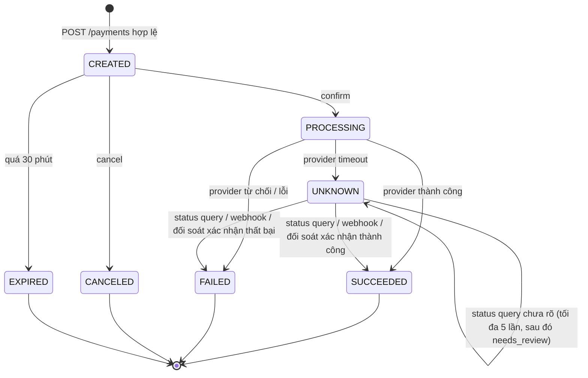
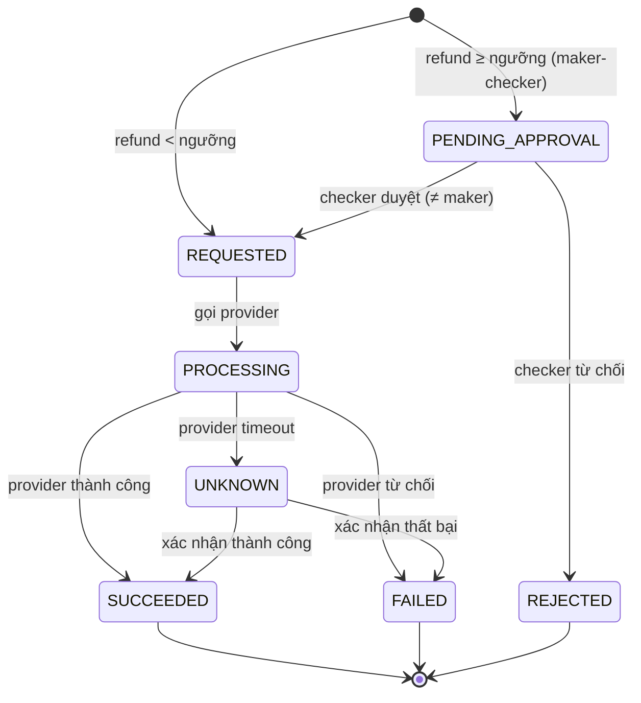
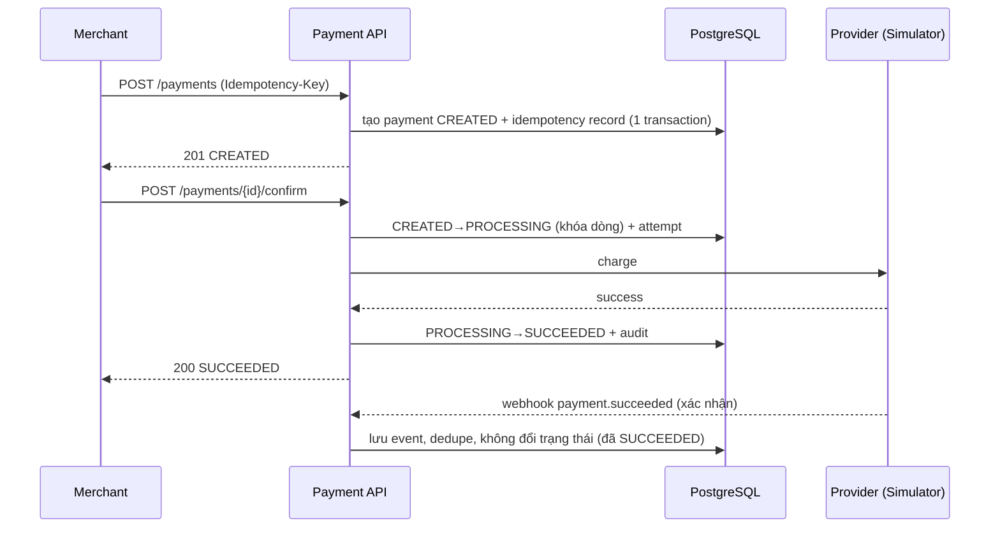
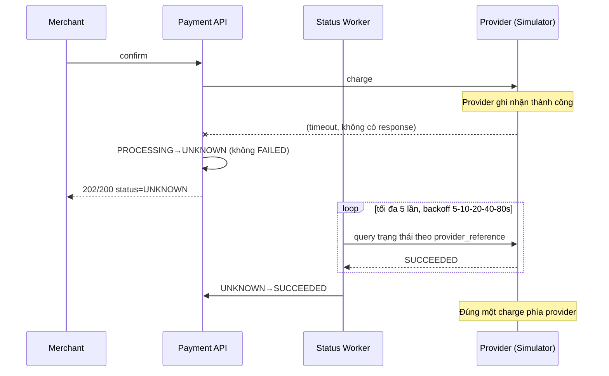
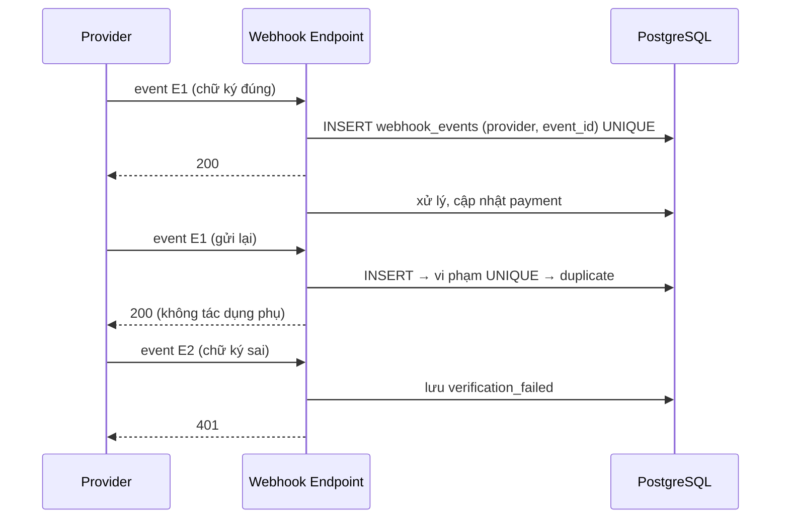

# Payment Lifecycle — State Machine, Sequence và Bất biến

Phiên bản 0.1. Sơ đồ dùng Mermaid (hiển thị trực tiếp trên GitHub). Khi sang Phase 1, vẽ lại luồng nghiệp vụ dưới dạng **BPMN 2.0** (`.bpmn`, bằng Camunda Modeler hoặc draw.io) để dùng cho hồ sơ BA; file Mermaid ở đây là nguồn sự thật cho state machine khi lập trình.

> *Đơn giản hóa:* Payment Lab gộp authorization và capture thành một bước `confirm`. Các hệ thống thực tế thường tách hai bước và có settlement nhiều ngày.

## 1. State machine của Payment



### Bảng chuyển trạng thái (nguồn cho TS-024)

| Từ | Sự kiện | Điều kiện (guard) | Đến | Tác dụng phụ |
|---|---|---|---|---|
| (mới) | `create` | Validate hợp lệ, merchant ACTIVE, idempotency OK | CREATED | Ghi payment, audit, idempotency record; đặt `expires_at` |
| CREATED | `confirm` | Chưa có payment SUCCEEDED cùng `merchant_reference`; ví đủ số dư (nếu WALLET) | PROCESSING | Tạo `payment_attempt`; gọi provider đúng một lần |
| CREATED | `cancel` | — | CANCELED | Audit |
| CREATED | `expire` | `now ≥ expires_at` | EXPIRED | Audit |
| PROCESSING | `provider_success` | — | SUCCEEDED | Ghi `succeeded_at`; trừ ví (nếu WALLET); phát sinh dữ liệu đối soát |
| PROCESSING | `provider_decline` | — | FAILED | Ghi `failure_code`; hoàn giữ chỗ ví |
| PROCESSING | `provider_timeout` | Quá 10 giây | UNKNOWN | Lên lịch status query; **không** tạo charge mới |
| UNKNOWN | `status_success` | Provider xác nhận | SUCCEEDED | Như `provider_success` |
| UNKNOWN | `status_failed` | Provider xác nhận | FAILED | Như `provider_decline` |
| UNKNOWN | `status_unknown` | `attempts < 5` | UNKNOWN | Tăng attempts, backoff |
| UNKNOWN | `status_unknown` | `attempts = 5` | UNKNOWN | Đặt `needs_review = true` |
| SUCCEEDED/FAILED/CANCELED/EXPIRED | bất kỳ sự kiện đổi status | — | (từ chối) | 409 `INVALID_STATE_TRANSITION`; riêng webhook mâu thuẫn thì ghi `STATE_CONFLICT` |

### Các chuyển trạng thái **không hợp lệ** tiêu biểu
- SUCCEEDED → FAILED, FAILED → SUCCEEDED (kể cả khi webhook muộn báo ngược: ghi anomaly, không đổi status — BR-PAY-014).
- CANCELED/EXPIRED → PROCESSING.
- PROCESSING → CANCELED (đã gọi provider, không hủy được).
- CREATED → SUCCEEDED (phải đi qua PROCESSING).

## 2. State machine của Refund



### Giữ chỗ (reservation) khi hoàn tiền

```
refundable = payment.amount
           − Σ refund.amount  (status = SUCCEEDED)
           − Σ refund.amount  (status ∈ PENDING_APPROVAL, REQUESTED, PROCESSING, UNKNOWN)
```

| Trạng thái refund | Có giữ chỗ không? | Ghi chú |
|---|---|---|
| PENDING_APPROVAL, REQUESTED, PROCESSING | Có | Đang xử lý |
| UNKNOWN | **Có** | Chưa biết kết quả; giữ đến khi xác định |
| SUCCEEDED | Có (đã tính vào tổng đã hoàn) | |
| FAILED, REJECTED | Không | Giải phóng ngay |

Việc tính `refundable` và tạo refund phải nằm trong cùng transaction có khóa (ví dụ khóa dòng payment `SELECT … FOR UPDATE`) để hai refund song song không cùng thấy một số dư cũ.

## 3. Sơ đồ tuần tự

### 3.1 Luồng thành công



### 3.2 Timeout nhưng provider đã thành công (Golden Path GP-01)



### 3.3 Webhook trùng và sai chữ ký



## 4. Bất biến hệ thống (phải đúng ở mọi thời điểm)

| ID | Bất biến | Rủi ro nếu vi phạm | Kiểm chứng |
|---|---|---|---|
| INV-01 | Với mỗi `(merchant_id, merchant_reference)` có tối đa một payment SUCCEEDED | Khách trả hai lần cho một đơn | TS-032 |
| INV-02 | Σ refund SUCCEEDED ≤ payment.amount | Hoàn nhiều hơn số đã thu | TS-040, TS-042 |
| INV-03 | Số dư ví ≥ 0 | Chi vượt số dư | TS-033 |
| INV-04 | Một payment có tối đa một charge thành công ở provider | Trừ tiền hai lần | TS-026, TS-027, TS-031 |
| INV-05 | Trạng thái terminal không đổi | Dữ liệu tài chính không đáng tin | TS-024, TS-030 |
| INV-06 | Mỗi transition có đúng một bản ghi audit | Không truy vết được | TS-025 |
| INV-07 | tổng reference duy nhất = số khớp + số reference có mismatch | Báo cáo đối soát sai | TS-063 |
| INV-08 | Mỗi `(provider, event_id)` chỉ xử lý một lần | Tác dụng phụ lặp | TS-048, TS-051 |

## 5. Các tình huống ngoại lệ cần BA phân tích thêm (backlog tuần 2)

1. Khách bấm confirm hai lần trên UI trong 200 ms.
2. Provider báo thành công, nhưng hệ thống nội bộ crash trước khi ghi DB → khôi phục bằng status query/đối soát.
3. Refund được tạo khi payment vừa chuyển từ UNKNOWN sang SUCCEEDED.
4. Webhook refund đến trước webhook payment.
5. Settlement file chứa giao dịch mà hệ thống nội bộ coi là FAILED (khách có thể đã bị trừ tiền).
6. Đồng hồ máy chủ lệch → ảnh hưởng timestamp webhook và expiry.
7. Merchant bị chuyển INACTIVE khi payment đang PROCESSING.
